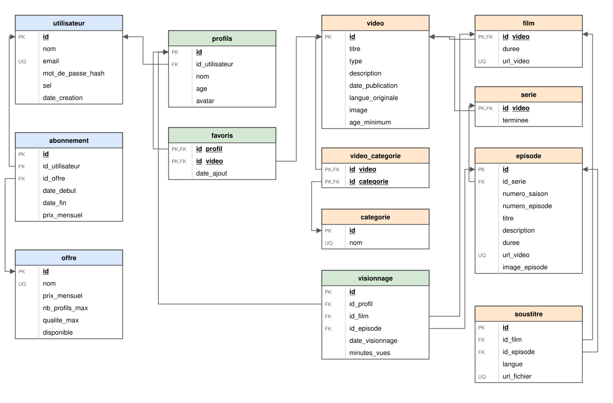

# Base de données d'une plateforme de streaming vidéo (SQL)

Base de données relationnelle d'un service de streaming de type Netflix. Elle gère le catalogue (films, séries, épisodes, catégories, sous-titres), les comptes, les abonnements, les profils, les favoris et l'historique de visionnage.

Écrite en **SQL (MySQL 8 / MariaDB)**, elle comprend des **procédures stockées**, des **fonctions**, des **déclencheurs**, des **vues**, des **rôles** et des **requêtes d'analyse** (fonctions de fenêtrage). Elle est vérifiée par **90 tests automatiques**.

Projet de bases de données de Licence 2 Informatique, à l'Université Jean Monnet (Saint-Étienne).

## Schéma relationnel



Le schéma se modifie dans [draw.io](https://app.diagrams.net) (`docs/schema.drawio`), ou se régénère avec `python3 docs/generer_schema.py`.

## Contenu

| Objet | Nombre | Exemples |
|---|---|---|
| Tables | 13 | `video`, `film`, `serie`, `episode`, `utilisateur`, `abonnement`, `visionnage`… |
| Procédures | 14 | `p_ajouter_film`, `p_souscrire_abonnement`, `p_catalogue_profil`… |
| Fonctions | 7 | `f_verifier_connexion`, `f_abonnement_actif`, `f_duree_totale`… |
| Déclencheurs | 7 | nombre maximum de profils, abonnements qui se chevauchent, contrôle d'âge… |
| Vues | 4 | `v_catalogue`, `v_utilisateurs`, `v_statistiques_offres`, `v_popularite_videos` |
| Rôles | 3 | administrateur, abonné, invité |
| Requêtes d'analyse | 9 | classement par catégorie, activité par semaine, taux de complétion, revenus… |

**Règles de gestion appliquées par la base elle-même :**
- Une vidéo est soit un film, soit une série, et son type ne peut plus changer ensuite. Une vidéo peut avoir plusieurs catégories.
- Un sous-titre ou un visionnage concerne soit un film, soit un épisode, jamais les deux.
- Les mots de passe sont stockés sous forme d'empreinte SHA-256 salée, jamais en clair. La connexion ne révèle pas si l'email existe.
- Un abonnement a ses propres dates et garde le prix payé, même si le prix de l'offre change ensuite. Deux abonnements d'un même utilisateur ne peuvent pas se chevaucher. Un renouvellement commence le lendemain de la fin de l'abonnement en cours.
- Le nombre de profils est limité par l'offre en cours.
- Un profil enfant ne peut ni regarder ni mettre en favori une vidéo interdite à son âge.
- Chaque ajout de film ou de série se fait dans une **transaction** : en cas d'erreur, rien n'est enregistré.

## Installation

```bash
# macOS
brew install mysql && brew services start mysql      # ou : brew install mariadb

# Ubuntu / Debian
sudo apt install mariadb-server
```

```bash
./installer.sh                      # crée la base « streaming » avec les données de démonstration
./installer.sh "mysql -u root -p"   # si root a un mot de passe
./tests/lancer_tests.sh             # lance les 90 tests
mysql -u root streaming < sql/06_requetes_analyse.sql
```

Testé avec MySQL 8.0 et MariaDB 10.11.

## Exemples

```sql
-- Ajouter un film (les catégories sont créées si besoin)
CALL p_ajouter_film('Inception', 'Un voleur infiltre les rêves.', '2010-07-16', 'Anglais',
                    'inception.jpg', 12, 'Science-fiction, Thriller', 148,
                    'https://cdn.example.com/inception.mp4', @id_film);

-- Créer un compte, s'abonner pour 12 mois, ajouter un profil
CALL p_creer_utilisateur('Bob Martin', 'bob.martin@example.com', 'MotDePasse!2024', @bob);
CALL p_souscrire_abonnement(@bob, 'Premium', 12, @abonnement);
CALL p_ajouter_profil(@bob, 'Lucas', 8, 'avatar.png', @lucas);

SELECT f_verifier_connexion('bob.martin@example.com', 'MotDePasse!2024');  -- 1
CALL p_catalogue_profil(@lucas);           -- seulement les vidéos autorisées à 8 ans
CALL p_recuperer_favoris_utilisateur(@bob);
```

## Requêtes d'analyse

Le fichier `sql/06_requetes_analyse.sql` contient 9 requêtes sur les données de démonstration. Elles utilisent des jointures, des sous-requêtes, des agrégations et des fonctions de fenêtrage (`RANK() OVER`, `SUM() OVER`). Par exemple, la part de chaque offre dans le revenu mensuel :

```
+-------------+----------------+----------------+-----------------+------------------------+
| offre       | abonnes_actifs | revenu_mensuel | part_revenu_pct | chiffre_affaires_total |
+-------------+----------------+----------------+-----------------+------------------------+
| Premium     |              2 |          39.98 |            48.2 |                 479.76 |
| Standard    |              2 |          26.98 |            32.5 |                 225.33 |
| Essentiel   |              2 |          15.98 |            19.3 |                  87.89 |
| Découverte  |              0 |           0.00 |             0.0 |                  29.94 |
+-------------+----------------+----------------+-----------------+------------------------+
```

Les autres requêtes donnent : les 3 vidéos les plus regardées de chaque catégorie, l'activité par semaine, le taux de complétion des films, le nombre de spectateurs qui finissent chaque série, le temps passé par tranche d'âge, les abonnements à relancer avant leur fin, les anciens abonnés, et des recommandations à partir des favoris communs.

## Tests

`tests/lancer_tests.sh` crée une base temporaire et exécute **90 tests**. Ils vérifient chaque procédure, fonction, déclencheur et vue, y compris les cas d'erreur : doublons, identifiants inexistants, transaction annulée, limites d'âge, chevauchement d'abonnements, suppressions en cascade… Le script vérifie ensuite que l'installation complète, les requêtes d'analyse et `suppression.sql` s'exécutent sans erreur.

```
+------------------------+
| bilan                  |
+------------------------+
| 90 / 90 tests réussis  |
+------------------------+
```

## Organisation

```
sql/
├── 01_schema.sql            tables, clés, index, contraintes CHECK
├── 02_objets.sql            fonctions, procédures, déclencheurs
├── 03_vues.sql              vues
├── 04_roles.sql             rôles et droits
├── 05_donnees.sql           données de démonstration
├── 06_requetes_analyse.sql  requêtes d'analyse
└── suppression.sql          supprime tous les objets
tests/
├── tests.sql                90 tests
└── lancer_tests.sh
docs/
├── schema.svg / schema.drawio / generer_schema.py
└── rapport_L2.pdf           rapport de la version rendue en L2
installer.sh
```

## Corrections par rapport à la version rendue en L2

La [première version du dépôt](../../tree/86bebe0) contient les fichiers tels qu'ils ont été rendus. Ils s'exécutaient, mais comportaient ces erreurs :

| Problème de la version d'origine | Correction |
|---|---|
| Chaque épisode était aussi ajouté dans la table `video`, comme une vidéo qui n'était ni un film ni une série | Les épisodes n'existent que dans `episode`, rattachés à leur série |
| Deux séries différentes ne pouvaient pas avoir un épisode du même titre dans la même langue (par exemple « Pilot ») | Un épisode est identifié par sa série, sa saison et son numéro |
| L'ajout d'un épisode d'une série inexistante laissait une vidéo orpheline | Transactions avec annulation en cas d'erreur |
| L'identifiant créé était relu en cherchant par titre | `LAST_INSERT_ID()` |
| Les dates d'abonnement étaient stockées dans l'offre, donc partagées par tous ses abonnés | Table `offre` pour les formules, et table `abonnement` pour les dates propres à chaque utilisateur |
| Mots de passe stockés en clair | Empreinte SHA-256 avec un sel différent par utilisateur |
| La connexion indiquait si l'email existait (« Email incorrect ») | Même réponse dans les deux cas |
| `f_abonnement_actif` modifiait la table `utilisateur` | Le statut est calculé à partir des dates. La colonne `abonnement_actif` est supprimée |
| `f_nombre_episodes` et `f_duree_totale` renvoyaient -1 pour une série sans épisode | Elles renvoient 0. `f_duree_totale` trouve seule s'il s'agit d'un film ou d'une série |
| `p_recuperer_favoris_utilisateur` renvoyait un résultat séparé par favori (curseur) | Une seule requête avec jointures |
| `p_supprimer_favoris_par_profil` supprimait les favoris un par un avec un curseur | Un seul `DELETE` |
| Les catégories étaient stockées dans un seul texte (« Drame, Crime ») | Tables `categorie` et `video_categorie` |
| Déclencheurs qui refaisaient le travail des contraintes `UNIQUE` | Contraintes `UNIQUE` et `CHECK`, avec des messages d'erreur clairs dans les procédures |
| Rôles décrits dans le rapport mais pas créés | Rôles administrateur, abonné et invité dans `04_roles.sql` |

Ajouts : l'historique de visionnage, les restrictions d'âge, les vues, les requêtes d'analyse, les données de démonstration, les tests automatiques et la compatibilité avec MySQL et MariaDB.

## Auteurs

Projet réalisé en L2 par **Majd CHAMAS**, **Asma MOUHLI** et **Kanza MILOUDI**. Version reprise et améliorée par **Majd CHAMAS**.
